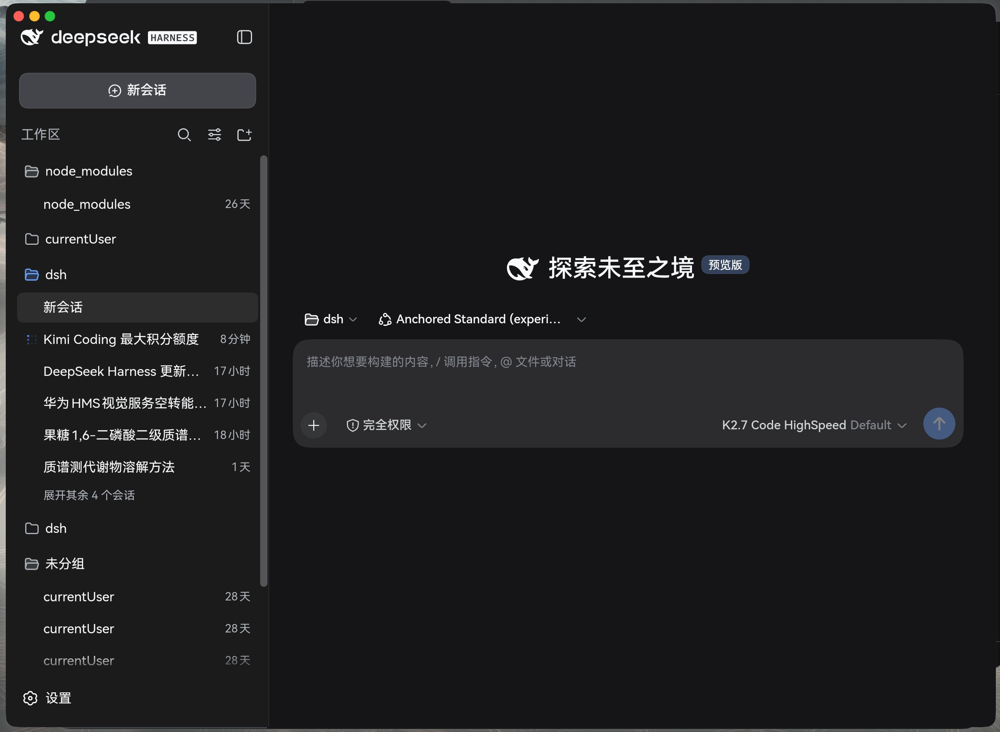

# DSH-desktop-for-HarmonyOS



[DeepSeek Harness](https://github.com/anywhere-labs/deepseek-harness-desktop) 的
HarmonyOS PC（2in1）原生客户端。不是简单的 WebView 套壳——而是一套把
**HarmonyOS 系统能力**（窗口、卡片、快捷栏、长时任务、端侧 AI、分布式协同）
与 DSH 宿主（`dsh web`）深度对接的桌面工作台。

> 业务 UI 由系统侧的 `dsh web` Host 提供（本应用加载 `http://127.0.0.1:3080`）；
> 本仓库提供原生外壳、系统融合层与 ArkTS 桥。

---

## ✨ HarmonyOS 原生亮点

### 🪟 窗口工程（ArkUI）

| 特性 | 说明 |
| --- | --- |
| 无边框窗口 | `setWindowDecorVisible(false)`，左上角自绘 macOS 风格红绿灯，hover 出图标，随侧边栏折叠联动 |
| **自绘窗口描边** | 系统 1px 细边无 API 可调 → 根层自绘 2vp 描边，圆角 16vp 与系统窗角实测对齐；深浅色自适应；最大化/全屏自动隐藏（与 macOS/Windows 一致） |
| 主题色衬底 | 根容器铺与 Web 主题同色衬底，掩盖 ArkWeb 缩放窗口时的异步重绘空白 |
| 权威窗口状态 | 最大化判定统一走 `window.getWindowStatus()` + `windowStatusDidChange` 事件，绿灯/拖拽/描边零脱同步 |
| 顶部热区 | 28vp 拖拽移动、双击最大化/还原、右键系统菜单；最大化态拖拽先 `recover()` |
| 几何持久化 | 窗口大小/位置经 `preferences` 跨启动恢复 |

### 🧩 系统融合（PC 专属能力）

| 特性 | 说明 |
| --- | --- |
| **服务卡片 ×3** | 迷你/宽/大三种尺寸桌面卡片，实时展示 DSH 会话状态（宿主侧 `updateCard` 推送，`getFormsInfo()` 零权限枚举）；卡片手动刷新 5s 内应答 |
| **快捷栏进度** | DeskTopExtensionKit（PC 专属 Kit）：dock 图标进度条 + 状态栏图标，随会话启停亮灭 |
| **长时任务常驻** | `MODE_TASK_KEEPING` 连续任务（**PC/2in1 免 ACL**），关窗/后台后进程与桥常驻，系统挂无提示音常驻通知 |
| 系统通知 | 文本/长文本/带按钮通知，点击唤起窗口；按钮事件可回传宿主触发自动化 |
| 深浅色三态 | 跟随系统/浅色/深色循环切换并持久化；所有自绘颜色按应用有效模式计算，不受系统/应用模式相反影响 |

### 🌉 DSH ↔ ArkTS 桥（77 动作）

node 侧 `bridge/bridge-server.mjs`（零依赖回环服务）+ ArkTS 侧 `BridgeAgent`（长轮询执行），
让 `dsh web` 与任意脚本可调 ArkTS 系统能力：

- **窗口与显示**：`listMainWindows` / `snapshotWindow`（含 `fetchFile` 字节取回）/
  `getWindowLayouts` / `getSelfWindowInfo` / `moveSelfWindow` / `resizeSelfWindow` /
  `setSelfWindowMode` / `listDisplays` / `requestScreenCapture`
- **卡片与桌面**：`updateCard` / `statusBarAdd|Remove|Status` / `quickBarAdd|List|Status|Progress`
- **通知与提醒**：`notify` / `dismissNotification` / `subscribeNotificationActions` /
  `publishReminder` / `cancelReminder`
- **端侧 AI**：`ocrImage`（Core Vision Kit）/ `localChat`（端侧本地大模型）/
  `nlpEntity` / `nlpSegment` / `embedText` / `embedBatch` / `ttsSpeak`
- **应用与系统**：`startAbilityByType`（垂类面板）/ `startAbility`（含 flags）/ `openLink` /
  `resolveAbilityByUri` / `getAllBundleInfo` / `thermalLevel` / `usbDevices` /
  `calendarQuery` / `setClipboard` / `getClipboard`
- **分布式协同**：`listDistributedDevices` / `devicePerception` / `acsCreate|Connect|Send|Destroy|Status`
  （abilityConnectionManager）/ `kvOpen|kvPut|kvGet|kvList|kvSync`（DeviceKVStore）/
  `dsoStart|Stop|Write|Read|Status`（分布式数据对象）/ `udmfShare|udmfQuery`
- **通道与杂项**：`wsServerStart|Stop|Send|Status`（ArkTS 侧 WS 服务端）/
  `shareShow` / `getPermissionStatus` / `requestPermissions` / `watchEvents` 等

> 完整清单与实测边界见 `bridge/README.md`。

### 📱 跨端协同

- 手机/平板壳（同 bundle，姊妹仓库）：移动端桥经 **LAN → 互联网隧道 → 协同 P2P** 三级候选
  把 DSH 通知推成手机/平板的系统通知；设备上下线、共享记忆、遥控 PC 共用一条 WebSocket
- 同 bundle 打通「同应用跨设备」API 前提：abilityConnectionManager / DeviceKVStore / 分布式数据对象

### 🔒 安全

- `javaScriptProxy` **URL 白名单**：`dshNative` 仅允许 `http://127.0.0.1:3080` 调用
- 桥只绑回环（`127.0.0.1`）；签名材料全部出仓（`key/` 已 gitignore）
- 权限按需申请并如实回报：normal 级声明即得，user_grant 首次弹窗，ACL 类不使用

---

## 架构

```
┌────────────────────────────────────────────────────┐
│ HarmonyOS HAP（本仓库）                              │
│  ArkUI 无边框窗口 + ArkWeb                            │
│   ├─ 窗口工程：红绿灯/描边/衬底/热区/状态持久化          │
│   ├─ dshNative JS 桥（URL 白名单）                    │
│   ├─ BridgeAgent ──长轮询──┐                         │
│   ├─ 服务卡片 ×3 / 快捷栏 / 状态栏                     │
│   └─ MODE_TASK_KEEPING 长时任务                       │
└──────────────────────┬─────────────────────────────┘
                       │ http://127.0.0.1:3080（业务 UI）
┌──────────────────────▼─────────────────────────────┐
│ `dsh web` Host（系统侧 Node 进程，会话/插件/工具）      │
│   └─ bridge-server.mjs :3131 ◄──长轮询── BridgeAgent │
└──────────────────────┬─────────────────────────────┘
                       │ LAN / 隧道 / 协同（WS）
┌──────────────────────▼─────────────────────────────┐
│ 手机 / 平板壳（姊妹仓库）：系统通知 / 遥控 / 共享记忆     │
└────────────────────────────────────────────────────┘
```

## 快捷键

| 快捷键 | 作用 |
| --- | --- |
| `Ctrl/Cmd + W` | 隐藏 / 最小化窗口 |
| `Ctrl/Cmd + R` | 刷新页面 |
| `Ctrl/Cmd + +/-` | 放大 / 缩小 |
| `Ctrl/Cmd + 0` | 重置缩放 |
| `Ctrl/Cmd + Shift + L` | 循环切换 跟随系统 / 浅色 / 深色 |

## 环境要求

- DevEco Studio 6.1.0.860（含 HarmonyOS SDK 6.1.0（API 23，version 6.1.0.105）/ hvigor 6.23.7）
- HarmonyOS / OpenHarmony `2in1` 设备或模拟器
- 系统侧已安装并可运行 `dsh web`（Node.js）

## 构建

```bash
./build.sh            # release（默认）
./build.sh debug      # debug
```

输出：`entry/build/default/outputs/default/entry-default-signed.hap`

> **签名**：本仓库的 `build-profile.json5` 不含任何签名配置（`signingConfigs` 已清空）。
> 首次构建前，在 DevEco Studio 中配置签名（`File > Project Structure > Signing Configs`），
> 或手动在 `build-profile.json5` 的 `signingConfigs` 中填入你自己的证书。
> **切勿把签名材料提交到仓库**：证书/私钥/profile 请放在已被 `.gitignore` 忽略的
> `key/` 目录；本机若已有配置，可存为 `key/build-profile.local.json5`，构建前
> `cp key/build-profile.local.json5 build-profile.json5` 临时恢复，构建后
> `git checkout -- build-profile.json5` 还原为净化版。

## 运行

`dsh web` 需先运行在目标设备的 `127.0.0.1:3080`（或用 `hdc` 转发）。macOS 开发时可用：

```bash
./launch.sh   # 启动 dsh web + hdc 端口转发 + 安装 + 启动应用
```

鸿蒙本机一键启动（解析 token + 幂等拉起 bridge-server + 安装启动）：

```bash
bash launch-local.sh
```

## 与 dsh web 的连接与认证（token）

dsh web 每次启动会生成一个随机的进程 token；浏览器需带 `?token=…` 访问一次，
由 dsh web 签发一个绑定 `127.0.0.1:3080` 的持久签名 cookie，之后 30 天内免 token。
本应用是 WebView（沙箱内不能跑 shell 去解析 dsh web 打印的 token），因此支持两种接入方式：

**方式一（推荐）：给 dsh web 打「本地回环免认证」补丁**

补丁文件：`scripts/dsh-client-connection-loopback.patch`（本仓库随附）

```sh
cd "$(npm root -g)/@deepseek-ai/dsh/node_modules/@deepseek-ai/dsh-client-connection"
git apply ~/path/to/scripts/dsh-client-connection-loopback.patch   # 或手工按文件注释加
```

补丁让 loopback（`127.0.0.1`）来源的**首页与 `/api` 请求都免 token/cookie**——
本应用裸连 `http://127.0.0.1:3080/?dsh-desktop-platform=darwin` 即可直接进入，
目录选择 / 权限 / 会话全部可用，且与浏览器 GUI 共用同一实例、内容全同步。
> 注意：升级或重装 dsh 后需重打此补丁。

**方式二（免补丁）：启动时传入 token，首次握手种 cookie**

本应用 `EntryAbility` 会读取启动参数 `dsh_token`；`Index.ets` 拿到后首次加载带
`?token=…` 完成一次性认证（自动换持久 cookie），之后免 token。启动辅助见
`launch-local.sh`（解析 dsh web 输出中的 token 并 `aa start` 传入），也可手动：

```sh
aa start -b com.example.dshdesktop -a EntryAbility --es dsh_token <从 dsh web 输出复制的 token>
```

> 无论哪种方式，都建议让 dsh web 以**单一实例**占用 `3080`，浏览器 GUI 与应用共用，
> 会话 / 工作区 / 权限实时一致。

## 已知限制

- OpenHarmony 用户应用无法自动拉起系统侧的 `dsh web`（沙箱限制），需手动 / 由系统脚本启动。
- ArkWeb 调整窗口大小时的重排/重绘延迟为引擎级行为（系统浏览器同样存在），
  应用层以主题色衬底掩盖，无法根治。
- 系统窗口 1px 细描边无公开 API 可调（已自绘覆盖）；快捷栏进度仅有
  NO_PROGRESS/NORMAL/PAUSED/ERROR 四态，无动画态。
- 第三方无障碍扩展在本机无法启用（系统未开放入口），UI 自动化走 `hdc → uitest` 通道。
- 自绘窗口控件依赖 WebView JS 注入与 DSH DOM 结构；DSH Web 升级后侧边栏折叠检测可能需要适配。
- 文件拖拽依赖目标设备 WebView 对 HTML5 `drop` 事件的支持，应用侧已开启窗口接收拖拽事件。
- 插件生态：纯前端插件可用；依赖 Electron/Node 主进程 API 的插件需额外适配。

## License

Apache License 2.0（见各源文件头部声明）。DeepSeek Harness 及其图标版权归原项目所有。
